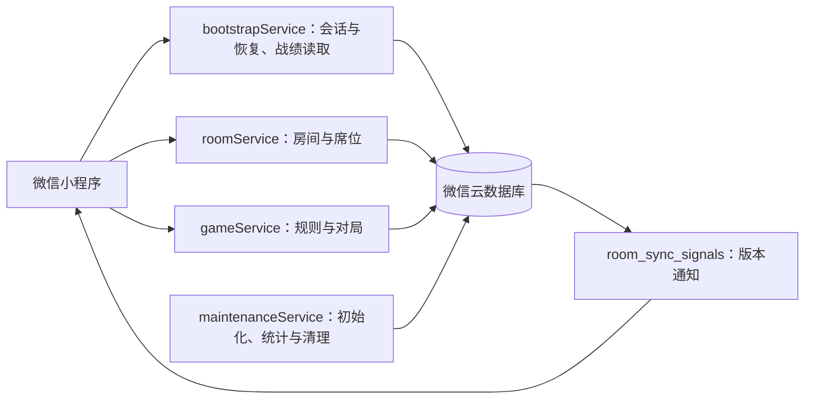

# secret dictator / 揭秘独裁者

**面向 5–10 人线下聚会的隐藏身份桌游微信小程序。** 小程序承担组局、身份分发、流程裁判和赛后复盘，让所有玩家都能参与讨论与博弈，无需额外安排主持人。

玩家分为自由派与极权派两个阵营，独裁者是极权派阵营中的特殊身份。每轮通过提名、投票组成政府，再由总统与总理处理政策牌；玩家需要结合公开结果与彼此的发言判断身份、争取阵营胜利。小程序保存隐藏信息并执行规则，讨论、说服和策略选择由玩家在线下完成。完整规则见 [游戏规则](docs/game_rules.md)。

项目已完成首个可玩版本（MVP），并持续完善观战、战绩、并发投票和恢复体验。客户端使用原生微信小程序，后端使用微信云开发。

## 一局游戏如何进行

1. **组局**：创建个人资料，房主选择 5–10 人房间，其他玩家通过 6 位房号或小程序分享进入。
2. **入座与准备**：大厅内选择空席，玩家坐满并全部准备后，由房主开始游戏；观战者不占玩家名额。
3. **查看身份**：每位玩家只查看自己有权知道的身份与队友信息。
4. **讨论与行动**：线下讨论，按页面提示完成提名、投票、立法、否决和总统权力；服务端验证每一步操作并同步桌面。
5. **终局复盘**：满足胜利条件后，公开全部身份、胜负原因和关键时间线，回顾各轮投票与政策处理。

一个人也可以体验完整流程：创建**单人模式**房间，补齐虚拟玩家并统一准备，再切换受控席位手动操作。适合熟悉规则、演示和开发验证；虚拟玩家没有自动决策能力。

## 已实现的能力

| 能力 | 当前支持 |
| --- | --- |
| 房间与席位 | 5–10 名玩家、房号与分享加入、大厅人数调整、准备与退出、空席认领 |
| 观战 | 每间房固定 3 个观战席，局中可加入观战，只能查看公共信息 |
| 完整规则 | 提名、投票、三次选举失败后的混乱政策、立法、否决、总统权力及标准胜负判定 |
| 隐藏信息保护 | 按身份与行动权限展示手牌、队友、调查结果和政策预览 |
| 同步与恢复 | 实时信号通知、轮询降级、切后台恢复、活跃房间恢复、重复请求与并发校验 |
| 历史与复盘 | 局内公开轮次记录、按票型分组的投票结果、终局身份与政策处理时间线 |
| 个人战绩 | 普通多人模式正常终局后异步累计对局数、胜率和两类阵营胜场 |
| 单人演练 | 虚拟玩家补位、统一准备、切换受控席位，使用同一套规则与状态机 |

产品面向熟人线下聚会，当前不提供陌生人匹配、线上语音/视频、AI 对战、排行榜或自定义规则。房间与结果是临时数据：大厅保留 30 分钟，对局最长 3 小时，终局结果保留 30 分钟；个人聚合战绩不等于永久逐局档案。

界面采用暗色谍报档案与复古桌游桌面风格。页面参考设计及图片素材位于 [reference/](reference/)，参考图用于说明视觉基调，实际页面以当前实现为准。

## 技术架构

| 层次 | 实现 |
| --- | --- |
| 客户端 | 原生微信小程序：JavaScript、WXML、WXSS；房间与结果页面使用分包 |
| 服务端 | 4 个 JavaScript 云函数，使用 `wx-server-sdk` |
| 数据与资源 | 微信云数据库、微信云存储 |
| 本地测试 | Node.js 脚本，使用内存数据库与微信 API 的 stub/mock |



服务端是游戏规则与状态的唯一裁判：`game_core` 保存完整游戏真相，公共快照与个人私密快照分别生成，完整身份、牌堆和手牌不会整体下发给客户端。写操作经过身份、阶段、幂等与并发校验，客户端收到成功回执后重新拉取快照更新页面。

客户端监听的 `room_sync_signals` 只包含房间状态与版本等通知；收到变化后通过云函数读取有权限的内容。监听不可用时回退轮询，页面隐藏时停止同步。具体数据流和安全边界见 [架构说明](docs/architecture.md)。

## 项目结构

```text
frontend/
  app.js                  小程序入口与云环境配置
  pages/                  首页、个人资料、创建房间
  packageRoom/            大厅、对局桌面、身份、规则、历史
  packageResult/          终局结果与复盘
  components/             公共组件
  services/               会话服务调用
  utils/                  路由、资料缓存与资源工具
cloudfunctions/
  bootstrapService/       会话、房间恢复、个人战绩查询
  roomService/            房间生命周期、席位与单人模式
  gameService/            游戏状态机、命令、快照与结果
  maintenanceService/     集合初始化、战绩事件消费、过期资源清理
scripts/                  后端测试入口
tests/                   前后端自动化测试
docs/                    产品、规则、架构、API 与演进记录
reference/               页面参考图、原始与处理后的素材
project.config.json       微信开发者工具项目配置
```

## 本地开发与运行

### 1. 准备环境并导入项目

准备微信开发者工具、可使用云开发的小程序 AppID，以及自己的云开发环境。运行本地测试还需要 Node.js。

克隆仓库后，在微信开发者工具中导入**仓库根目录**。项目配置已指定 `frontend/` 为小程序目录、`cloudfunctions/` 为云函数目录。仓库没有根级 `package.json` 或 Web 开发服务器入口，页面通过微信开发者工具编译与预览。

### 2. 替换环境与图片资源配置

仓库中的配置指向原开发环境，独立部署时需要改成自己的资源：

| 位置 | 需要配置的内容 |
| --- | --- |
| [`project.config.json`](project.config.json) | 将 `appid` 替换为自己的小程序 AppID |
| [`frontend/app.js`](frontend/app.js) | 将 `globalData.env` 替换为自己的云环境 ID |
| `frontend/` 中的 `cloud://` 地址 | 将页面与工具模块内的图片 fileID 替换为自己云存储中的地址 |

图片可从 `reference/processed_images/` 中选择页面引用的素材，上传到自己云存储的 `processed_images/` 路径，并按上传后实际 fileID 更新引用。图片地址分散在多个页面及政策轨工具模块中，**只修改 `app.js` 的环境 ID 不会迁移这些资源**。可用以下命令定位全部引用：

```bash
rg -n 'cloud://' frontend
```

页面通过 `wx.cloud.getTempFileURL` 获取临时 HTTPS 地址。新增图片优先使用 WebP，在 `image` 组件上显式设置 `webp="{{true}}"`；原图与处理后的备份分别保留在 `reference/origin_images/` 和 `reference/processed_images/`。

### 3. 部署云函数并初始化数据库

在微信开发者工具中选择自己的云环境，依次部署 `maintenanceService`、`bootstrapService`、`roomService`、`gameService`，使用云端安装依赖。各云函数目录自带 `package.json`，后端通过 `cloud.DYNAMIC_CURRENT_ENV` 使用部署所在环境。

首次运行页面前，在云开发控制台以空事件 `{}` 执行一次 `maintenanceService`，确认返回 `success: true`，并完成集合初始化。集合清单在其 `index.js` 的 `COLLECTIONS` 中；业务请求不会自动补建缺失集合。同步部署并确认 [`maintenanceService/config.json`](cloudfunctions/maintenanceService/config.json) 中的定时触发器已生效，以持续处理战绩事件和过期资源。

数据库权限也需要在目标云环境配置：业务集合只允许服务端访问；`room_sync_signals` 仅允许当前活跃房间成员读取，禁止客户端写入。维护函数仅用于受控维护与定时任务，不作为客户端业务入口。当前仓库不提供可一键应用的数据库安全规则，配置边界见 [架构说明](docs/architecture.md)。

### 4. 编译并验证流程

完成云环境、资源和权限配置后，在微信开发者工具中编译。可先用单人模式验证“创建资料 → 创建房间 → 补齐虚拟玩家 → 准备开局 → 切换席位操作 → 终局复盘”，再使用多个微信用户验证普通多人房间、分享加入、观战和切后台恢复。

单人模式仍依赖云环境，并非离线模式。本地 mock 测试不能替代真实数据库权限、云存储访问与多人同步验证。

## 自动化测试

在仓库根目录执行，以下命令适用于 Bash / Zsh：

```bash
# 后端：规则、状态机、权限隔离、并发、恢复与维护
node scripts/run-backend-tests.js || exit 1

# 前端：视图映射、页面交互、同步、缓存与投票确认
for f in tests/frontend/*.test.js tests/frontend/*/*.test.js; do
  node "$f" || exit 1
done
```

测试使用本地 stub/mock，可独立于真实云环境运行。目标云环境集成验证和可重复的微信页面冒烟矩阵仍是后续工程改进方向，见 [路线图](docs/roadmap.md)。

## 文档与参与开发

首次阅读从 [文档中心](docs/README.md) 开始，再按关注点选择：

| 想了解什么 | 阅读入口 |
| --- | --- |
| 当前产品范围与行为 | [产品基线](docs/product.md) |
| 身份配置、回合流程与胜负条件 | [游戏规则](docs/game_rules.md) |
| 数据模型、同步、权限与运行边界 | [当前架构](docs/architecture.md) |
| 已实现的云函数 action、参数与错误语义 | [API](docs/api.md) |
| 后续候选需求与工程改进 | [路线图](docs/roadmap.md) |
| 首个可玩版本的交付与验证记录 | [MVP 记录](docs/releases/mvp.md) |

贡献前请阅读 [协作规范](AGENTS.md)。提交问题时附上复现步骤、预期与实际行为及相关日志；提交修复时补充针对原故障路径的验证。涉及多个模块、接口变化或重要产品取舍时先提交短 RFC，重大长期技术决策再记录 ADR，实现时同步受影响的当前文档与测试。

`docs/rfcs/` 中的草案用于讨论，`docs/archive/` 中的材料仅供历史追溯；两者不替代当前产品、规则、架构和 API 文档。

## 许可证

仓库根目录许可证为 [Apache License 2.0](LICENSE)。
